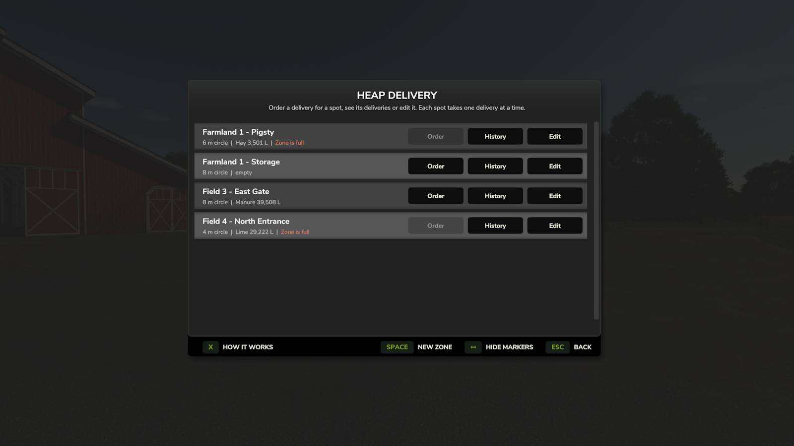
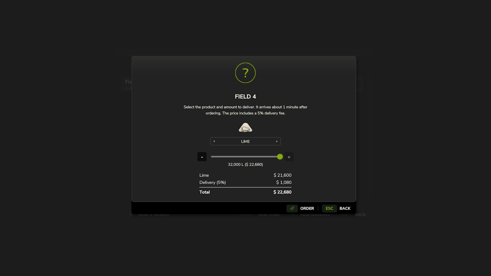
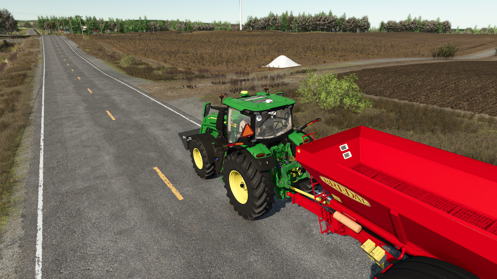
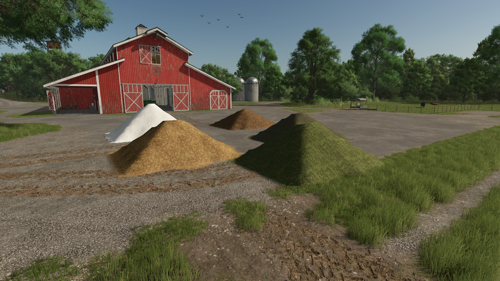

# Heap Delivery

> ✅ **Note:** This mod supports both **Singleplayer** and **Multiplayer**.

**Heap Delivery** lets you order bulk goods and have them delivered as a heap straight onto your own land.

No more driving back and forth to the shop or hauling bulk goods across the map. Order what you need, where you need it.

---

## 📷 Screenshots

---

## ✅ Features

- Order **lime, manure, straw, hay and grass** delivered as a heap on your own land
- Up to **50 delivery zones** per farm, in three sizes (4 m, 6 m and 8 m)
- Live placement preview that shows **slope warnings** and why a spot isn't allowed
- Uses **current in-game prices**, including your economy difficulty
- Smart handling on slopes, so **you still get the full amount**
- Full **delivery history** per zone, with automatic refunds
- Adjustable **delivery time** and **delivery fee**
- Zones are shown as **markers on the in-game map**

---

## 🚀 Getting Started

1. On foot, press **Alt + L** to open the Heap Delivery menu.
2. Press **New zone**, look at the ground where you want the heap and **left click** to place the zone (**right click** cancels).
3. On the zone's row, press **Order**, choose the product and the amount, and confirm.
4. Once the delivery time has passed, the heap appears in the zone and you get a notification.

---

## 📍 Delivery Zones

- Zones can only be placed on **land your farm owns**, at least **1 m** away from your other zones.
- While placing, the circle turns **green** where it fits and **red** where it doesn't, with the reason shown. The slope of the ground is also shown, with a warning on steep ground.
- Placing stops automatically if you get into a vehicle, pick up a tool or object, or open a menu.

---

## 🏷️ Naming & Managing Zones

- Zones are named after their field automatically (e.g. *Field 3*, then *Field 3a* for a second zone). Land without a field uses its farmland number.
- **Rename** adds a short description, for example *Field 3 - front entrance*. Descriptions go through the game's profanity filter.
- **Edit** on a zone's row opens **Size**, **Rename** and **Remove**.
- The menu shows each zone's size and what is currently lying in it. Full zones are shown in **red**.
- **Hide markers** hides zone circles and labels for you only. Other players still see them.

---

## 🛒 Ordering

- The order screen shows the product and its icon, an **amount slider in 500 L steps**, and a **receipt** with the product price, delivery fee and total. Payment is taken when you place the order.
- The slider only offers as much as still fits in the zone for that product.
- Each zone takes **one delivery at a time**. The **Order** button stays grey until it arrives, and the menu counts down the time left.

---

## 📏 Zone Capacity

- How much a zone holds depends on its **size** and the **product**. Light products like straw, hay and grass need much more room per liter than lime or manure.
- Different products **can't share a heap**. A zone only accepts the product already lying in it until that heap has been used up.

---

## ⛰️ Delivering on Slopes

- The game can only keep a heap on ground that isn't too steep, and each product piles up a little differently.
- On a slope, anything the zone can't hold is tipped **right next to it**, on your own land and away from your other zones, so you still receive the full amount. The delivery message tells you how much was placed next to the zone.
- The remainder is only refunded if all the surrounding ground is very steep.

---

## 🧾 History & Refunds

- **History** on a zone shows its **last 50 deliveries**: when they arrived, which product, how much was delivered, the amount paid (in red) and any refund (in green).
- Refunds include their share of the delivery fee.
- If you sell the land before a delivery arrives, the **whole order is refunded**.
- The last few liters of an order are **topped up for free** rather than refunded, because the game places heaps in small whole pieces.

---

## ⚙️ Settings

You'll find these under **Settings > Game Settings > Heap Delivery**:

| Setting | Range | Default | Description |
|---|---|---|---|
| Delivery time | 10 seconds to 60 minutes | 1 minute | How long after ordering a delivery arrives. Real time, paused while the game is paused. |
| Delivery fee | 0% to 25% | 5% | Added on top of the product price. |

Both settings are saved with your savegame. In multiplayer, only the **host or an admin** can change them.

---

## 🎮 Controls

| Key | Action |
|---|---|
| **Alt + L** | Open the Heap Delivery menu (on foot) |
| **Left click** / **Gamepad A** | Place the zone (while placing) |
| **Right click** / **Gamepad B** | Cancel placing |

You can rebind all keys under **Settings > Controls**.

---

## 📂 Installation

1. Download the `.zip` file from the [Releases](../../releases) section.
2. Move it into your `mods` folder:
   - On Windows: `Documents\My Games\FarmingSimulator2025\mods`
3. Launch the game and activate the mod from the in-game Mods menu.

---

## 📣 Feedback & Issues

Found a bug or have a feature suggestion? Go to the [Issues](../../issues) section of this repository to let me know.

---

## 📜 License

This mod is open-source. You may view, modify, or contribute to it via the GitHub repository.
Redistribution is not permitted without explicit permission from the original author.
If you modify or use parts of this code, please provide proper credit.